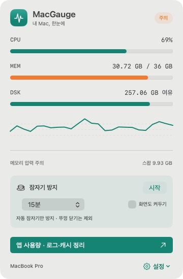

# MacGauge

**내 Mac, 한눈에.** SwiftUI로 만든 가벼운 macOS 메뉴 막대 시스템 모니터입니다. CPU·메모리·디스크 상태를 확인하고, 사용량이 큰 앱을 종료하거나 오래된 로그·캐시를 선택해 정리할 수 있습니다.

외부 패키지 없이 동작하며, 앱에서 네트워크 전송이나 관리자 권한을 요구하지 않습니다.

<p align="center">
  
</p>

<p align="center">접힌 상태 · 메뉴 막대에서 CPU·메모리 사용률 확인</p>

<p align="center">
  
</p>

<p align="center">실제 실행 화면 · 상태바 아래에 표시되는 화살표 없는 패널</p>

## 주요 기능

| 기능 | 내용 |
| --- | --- |
| 상태바 지표 | CPU·메모리 사용률을 3초 간격으로 표시 |
| 시스템 상세 | CPU 추이, 메모리 압력, 스왑, 디스크 여유 공간 |
| 잠자기 방지 | 15분·30분·1시간·2시간·직접 끌 때까지 유지, 화면 유지 선택 |
| 앱별 사용량 | 앱과 하위 프로세스의 CPU·메모리 합산, 검색·정렬 |
| 앱 종료 | 정상 종료 요청과 별도 확인을 거치는 강제 종료 |
| 로그·캐시 정리 | 30·60·90일 이상 수정되지 않은 파일 검색, 그룹별 선택·삭제 |
| 정리 내역 | 삭제·제외·오류 항목을 JSON으로 저장 |
| 설정 | 상태바 메모리 표시, 로그인 시 실행 선택 |

## 요구 사항

- macOS 14 이상
- Swift 6.0 이상을 포함한 Xcode 또는 Command Line Tools
- Git

현재 Apple Silicon Mac에서 빌드·실행을 확인했습니다. 빌드 스크립트는 실행한 Mac의 기본 아키텍처로 앱을 만듭니다. Universal 앱이나 공증된 배포 바이너리는 제공하지 않습니다.

## 빌드 및 설치

```bash
git clone https://github.com/bear2u/macGauge.git
cd macGauge
bash scripts/build-app.sh

mkdir -p "$HOME/Applications"
ditto dist/MacGauge.app "$HOME/Applications/MacGauge.app"
open "$HOME/Applications/MacGauge.app"
```

빌드 스크립트는 실행 파일과 아이콘을 묶어 `dist/MacGauge.app`을 만들고 개인 맥에서 실행할 수 있도록 ad-hoc 서명합니다. 기존 앱을 업데이트할 때는 MacGauge를 종료한 후 복사하세요. 외부 배포용 Developer ID 서명·공증은 포함하지 않습니다.

## 사용법

1. 메뉴 막대의 **CPU / MEM**을 클릭해 작은 패널을 엽니다.
2. **앱 사용량 · 로그·캐시 정리**를 누르면 상세 창이 열립니다.
3. **앱 사용량**에서 검색·정렬하고, 각 앱의 `…` 메뉴에서 종료를 요청합니다.
4. **로그·캐시 정리**에서 기간을 선택해 검색한 뒤, 정리할 그룹을 선택하고 확인합니다.

창을 닫아도 메뉴 막대에서 계속 실행됩니다. 패널은 바깥을 클릭하거나 `Esc`를 누르면 닫힙니다. 메뉴 막대를 우클릭하면 열기·종료 메뉴가 나타납니다.

| 단축키 | 동작 |
| --- | --- |
| `⌘1` | 작은 패널 열기·닫기 |
| `⌘2` | 상세 창 열기 |
| `⌘Q` | MacGauge 종료 |

단축키는 앱이 활성화된 상태에서 동작합니다. 로그인 자동 실행은 기본으로 꺼져 있으며 **설정 → 로그인 시 실행**에서 켤 수 있습니다. macOS의 추가 승인이 필요한 경우 설정 메뉴에 승인 화면으로 가는 항목이 나타납니다.

### 잠자기 방지

작은 패널 또는 **시스템** 화면에서 유지 시간을 선택하고 **시작**을 누르세요. **화면도 켜두기**를 선택하면 화면의 자동 꺼짐도 방지합니다. 활성화되면 상태바 아이콘이 커피잔으로 바뀌고, 패널에 남은 시간이 표시됩니다. 설정을 바꾸려면 **끄기** 후 다시 시작하세요.

- 기본값은 꺼짐이며, 앱을 다시 실행해도 자동으로 켜지지 않습니다.
- 시간이 끝나거나 **끄기**를 누르거나 앱을 종료하면 해제합니다. macOS에도 만료 시간을 전달하므로 앱 타이머가 지연돼도 제한 시간이 적용됩니다.
- 시스템의 영구 전원 설정을 변경하지 않으며 관리자 권한이 필요하지 않습니다.
- 화면 유지 중에도 수동 화면 잠금은 가능합니다. 화면 유지 기능이 화면 잠금을 해제하지 않습니다.
- **뚜껑 닫기·수동 잠자기·배터리 부족으로 인한 잠자기는 막지 않습니다.** 이 기능은 사용하지 않을 때 발생하는 자동 잠자기를 방지합니다. [Apple 전원 관리 API 설명](https://developer.apple.com/documentation/iokit/kiopmassertiontypepreventuseridlesystemsleep)
- 뚜껑을 닫고 사용하는 경우에는 외장 화면·전원·외장 키보드·마우스를 연결하는 macOS의 닫힌 디스플레이 사용 조건을 따라야 합니다. 관리자 권한으로 뚜껑 닫기 동작을 강제 변경하는 기능은 포함하지 않습니다. [Apple 지원 안내](https://support.apple.com/en-us/102501)

## 정리 범위와 보호

다음 위치의 허용된 파일만 검색합니다.

| 대상 | 정리 범위 |
| --- | --- |
| 앱 진단 로그 | `~/Library/Logs`의 `.log`, 회전·압축 로그, `.ips`, `.crash` |
| Maestro | `~/.maestro/tests` 아래의 `maestro.log` |
| npm·Gradle | npm 실행 로그와 Gradle 데몬 로그 |
| Dart | 분석 드라이버 캐시 |
| JetBrains | 플러그인 다운로드 압축본, 인덱스·캐시 |
| Electron | 다운로드 캐시의 ZIP·tar.gz 압축본 |
| Chrome | 기본 프로필의 웹·코드·GPU 캐시 |

**삭제는 휴지통을 거치지 않는 영구 삭제입니다.** 검색 결과는 자동 선택되지 않으며, 선택 후 확인창에서 승인해야 삭제합니다. 자동 삭제 기능은 없습니다.

- 프로젝트 원본·게임 빌드, 브라우저 쿠키·방문 기록, IDE 로컬 히스토리, AI 모델은 검색 대상에 포함하지 않습니다.
- 수정 시각과 현재 사용자 소유 여부를 검사합니다.
- 검색 및 삭제 직전에 `lsof`로 열린 파일 목록을 확인하고, 확인에 실패하면 중단합니다.
- 삭제 시 파일 식별자·크기·수정 시각 등을 다시 검사해 변경된 파일을 제외합니다.
- 심볼릭 링크를 따라가지 않으며, 폴더 전체를 재귀 삭제하지 않습니다.
- 검색 한도는 파일 50만 개입니다. 접근 오류나 한도 도달 시 일부만 검색했음을 표시합니다.

정리 내역은 `~/Library/Application Support/MacGauge/Reports`에 저장됩니다. 캐시는 이후 다시 생성될 수 있습니다. 표시되는 정리 용량은 파일 할당 용량의 합계이며, 공유 블록과 동시 작업 때문에 실제 확보 공간과 다를 수 있습니다.

## 지표 읽는 법

- **전체 CPU**는 모든 코어를 합친 0–100%입니다. **앱 CPU**는 코어 하나당 100%이므로 여러 코어를 사용하면 100%를 넘을 수 있습니다. 첫 샘플 이후부터 사용률을 표시합니다.
- **앱 메모리**는 프로세스별 physical footprint 합계입니다. 공유 메모리와 보조 프로세스 분류로 활성 상태 보기와 차이가 날 수 있습니다. 현재 사용자 계정에서 조회 가능한 GUI 앱을 대상으로 합니다.
- **전체 메모리**는 VM 통계에서 파일 캐시·회수 가능한 페이지를 뺀 근사치입니다. 메모리 압력은 OS 제공 지표입니다.
- CPU·메모리 부하는 불필요한 앱을 종료해 줄일 수 있습니다. 강제로 메모리를 할당하거나 `purge`를 실행하는 기능은 없습니다.
- 정상 종료 요청 뒤 저장 확인이 남아도 자동 강제 종료하지 않습니다. Finder·Dock 등 필수 UI와 MacGauge 자체의 종료는 앱 목록에서 제한합니다.
- 시스템 지표는 계속 갱신하며, 앱별 사용량은 상세 창이나 작은 패널이 보일 때 수집합니다.

## 개발 및 검증

Xcode에서 `Package.swift`를 열어 수정할 수 있습니다. 외부 Swift 패키지 의존성은 없습니다.

```bash
CLANG_MODULE_CACHE_PATH="$PWD/.build/ModuleCache" \
SWIFTPM_MODULECACHE_OVERRIDE="$PWD/.build/ModuleCache" \
swift test --disable-sandbox --cache-path .build/cache
```

자동 테스트 13개로 정리 허용 범위, 사용 중·변경된 파일 보호, 심볼릭 링크 차단, CPU 계산, 하위 프로세스 합산, 잠자기 방지의 만료·해제·실패 시 복구를 검증합니다. 실제 앱에서도 지표 표시·검색·테스트 앱 정상 종료와 패널 표시를 확인했습니다.

잠자기 방지는 실제 macOS의 `pmset -g assertions`에서도 확인했습니다. 화면 유지 선택에 따라 시스템·디스플레이 요청이 생성되고, 선택한 만료 시간이 등록되며, 수동 해제와 앱 종료 시 MacGauge의 요청이 사라집니다.

```text
Sources/MacGauge/           SwiftUI 화면, 메뉴 막대 패널, 앱 동작
Sources/MacGaugeCore/       시스템 지표, 프로세스 수집, 파일 정리
Tests/MacGaugeCoreTests/    핵심 로직 및 삭제 보호 테스트
Resources/                 앱 메타데이터
scripts/                   앱 빌드 및 아이콘 생성
```

## 라이선스

[MIT License](LICENSE) · Copyright (c) 2026 bear2u
